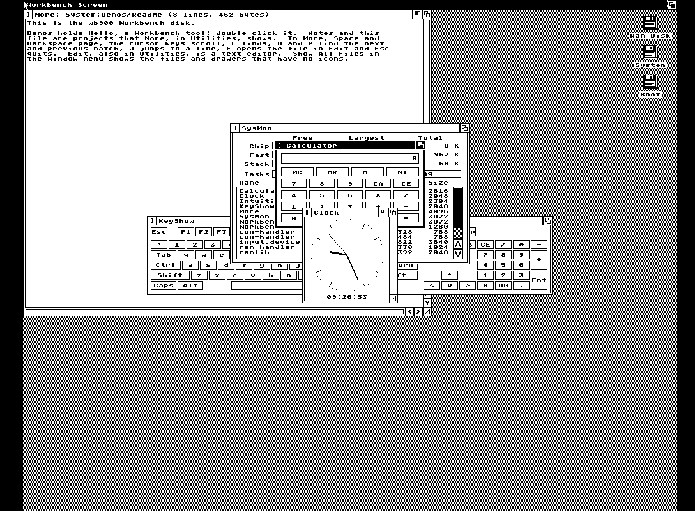

# wb900

An AmigaOS-style Workbench for the Commodore 900 (Z8001), on Exec900. The libraries are ported from AROS.



- **Libraries:** utility, keymap, graphics, layers, intuition, gadtools, icon, workbench, commodities, asl, diskfont; input.device, console.device and the CON:/RAW: handler.
- **Displays:**
  - HR card: 1024x800 or 1024x1024 mono, or 640x400 RGBI.
  - LC card (8568 VDC): Amiga-style modes up to 640x480, interlaced included.
- **Tools:** More, Edit, Calculator, Clock, KeyShow, SysMon, LogView, ScreenMode, and five commodities.

## Screenshots

[docs/screenshots.md](docs/screenshots.md) shows Workbench on every display model: HR mono at 1024x800 and 1024x1024, HR RGBI in both palettes, and the LC card at 640x200 and 640x400 interlaced.

## Packages

A release publishes built files, laid out as installed, for a distribution to assemble into a disk. `Boot/` is the boot partition and `System/` is SYS:.

| Package | Holds |
|---|---|
| `c900-wb900` | Libraries, devices, display drivers, fonts, `C/LoadWB`, the CON: handler, `S/Startup-Sequence` |
| `c900-wb900-utilities` | More, Edit, Calculator, Clock, KeyShow, SysMon, LogView |
| `c900-wb900-commodities` | ClickToFront, AutoPoint, DepthMenu, Blanker, NoCapsLock |
| `c900-wb900-prefs` | ScreenMode, and the Workbench 1.x palette |
| `c900-wb900-demos` | Hello, Notes, ReadMe |
| `c900-wb900-headers` | Headers, fd files and amiga.lib-style sources for building programs |

Each has `VERSION`, `.provenance`, `.contents` and `licenses/`. `make dist` builds them.

## Building

```
make deps
make all test
```

`make deps` unpacks the latest toolchain, Exec900, kboot and emulator releases into `deps/`. `C900_TOOLCHAIN`, `EXEC900`, `EXEC900_OUT`, `KBOOT` and `C900_EMU` name other copies.

The test disks in `build/wb900` boot in the emulator, for example `c900 --hr --disk=build/wb900/wbboot.bin`.

`make HRMODE=800|1024|rgbi` sets the HR jumper on every disk; `make LCMODE=640x400` sets the LC disk's mode.

## Layout

| Path | Holds |
|---|---|
| `libs/`, `devs/`, `fs/con` | The libraries, devices and the CON: handler |
| `wb/` | Workbench, LoadWB, the tools, commodities, fonts and icon art |
| `lib/` | amiga.lib-style helpers and stubs |
| `include/` | Public headers |
| `tests/` | Emulator tests: `tests/NAME.c` passes with a `PASS NAME` line |
| `tools/` | Host tools: icons, fonts, prefs files, packages, `make deps` |
| `aros/` | The AROS licence and upstream base |
| `docs/` | Documentation |

## Documentation

- [screenshots.md](docs/screenshots.md): every display model
- [porting.md](docs/porting.md): the C900 and Exec900 limits, sizes and approach
- [lc.md](docs/lc.md): the LC card driver
- [compiler.md](docs/compiler.md): writing C for this compiler, and toolchain requests
- [exec900.md](docs/exec900.md): requests to Exec900
- [backlog.md](docs/backlog.md): what remains

## Acknowledgements

Porting, bug fixes and new features in this repository were assisted by a coding agent (Anthropic's Claude).

## Licences

- AROS-derived code is under the AROS Public License 1.1 ([aros/LICENSE](aros/LICENSE), [aros/UPSTREAM.md](aros/UPSTREAM.md)).
- Edit (`wb/edit`) is AROS's JanoEditor, under GPL 2 ([wb/edit/COPYING](wb/edit/COPYING)).
- Files marked `SPDX-License-Identifier: MIT` are MIT ([LICENSE-MIT](LICENSE-MIT)).
