# Screenshots

wb900 on the MiSTer core's C900, from the `showcase` test (`tests/showcase.c`). Each model shows three steps: drawers, the tools, then ScreenMode.

Models: [Colours](#colours) · [HR mono, 1024x800](#hr-mono-1024x800) · [HR mono, 1024x1024](#hr-mono-1024x1024) · [HR RGBI, 640x400](#hr-rgbi-640x400) · [HR RGBI, 640x400, Workbench 1.x colours](#hr-rgbi-640x400-workbench-1x-colours) · [LC, 640x200](#lc-640x200) · [LC, 640x400 interlaced](#lc-640x400-interlaced)

## Colours

Each display mode has one depth:

| Card | Mode | Colours |
|---|---|---|
| HR | 1024x800, 1024x1024 mono | 2 |
| HR | 640x400 RGBI | 16 |
| LC | every mode | 2 |

The RGBI mode's 16 colours, in a gadtools palette (the colour chooser) on Workbench's own look:

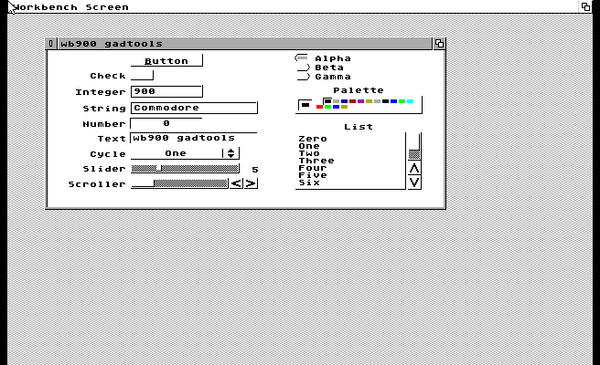

Workbench's own look on RGBI, before any windows open:

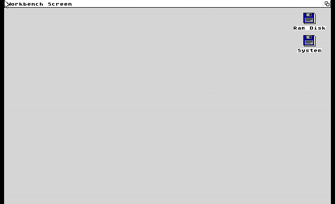

The LC card's two colours take the palette's first two pens: blue and white in the Workbench 1.x palette below.

## HR mono, 1024x800

The HR card in its 1024x800 mono mode.

**Drawers, each where its icon last put it**

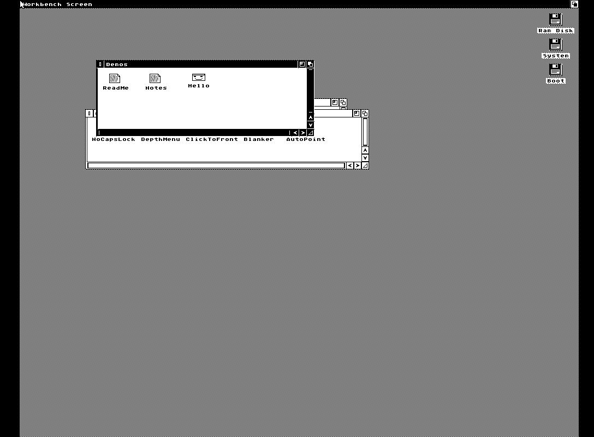

**More, KeyShow, SysMon, Calculator, Clock and a Shell running at once**

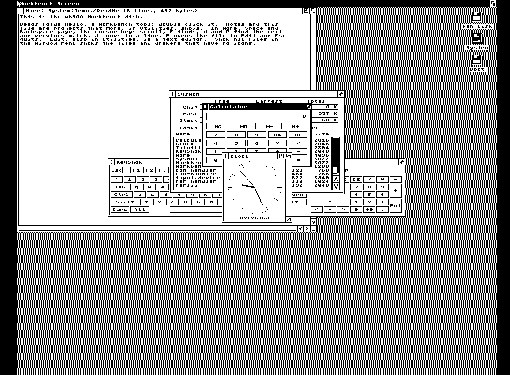

**ScreenMode, the display preferences**

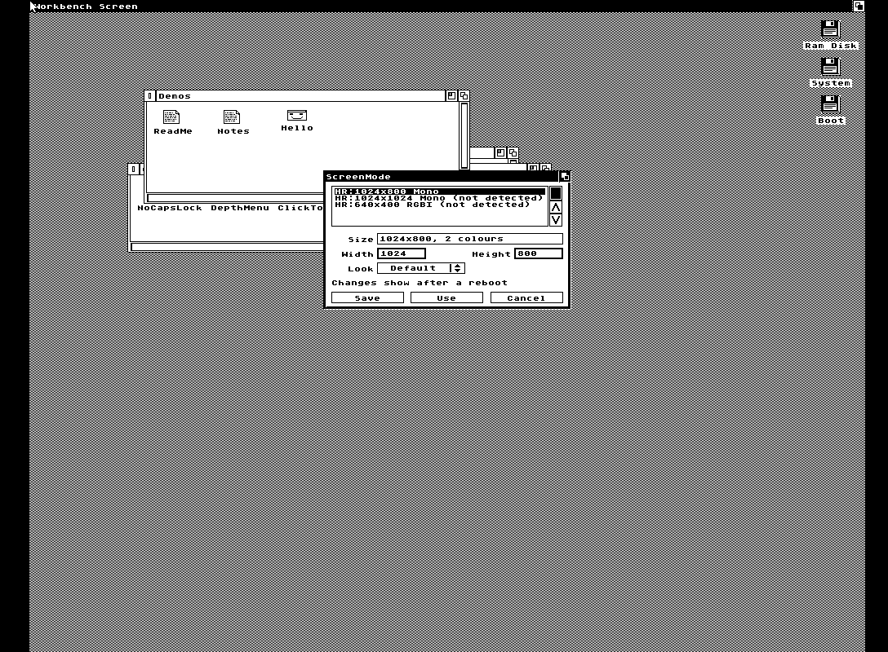

## HR mono, 1024x1024

The HR card with its jumper set for 1024x1024.

**Drawers, each where its icon last put it**

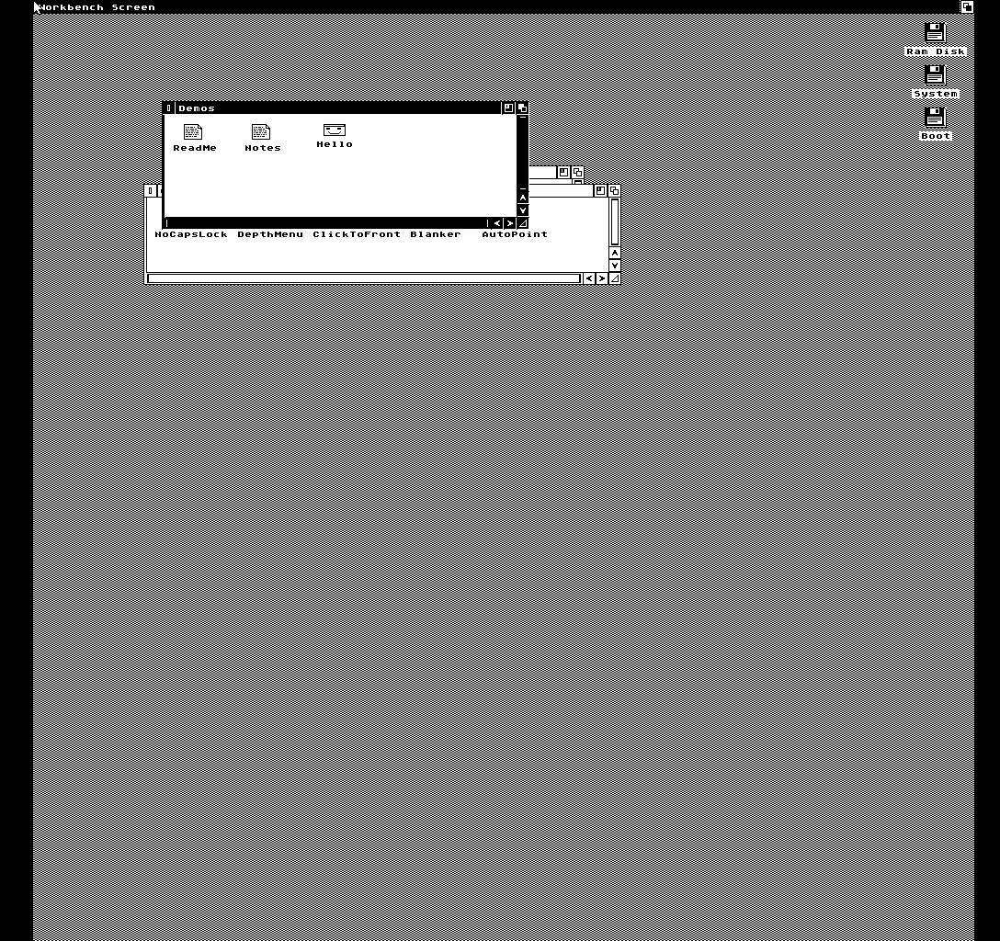

**More, KeyShow, SysMon, Calculator, Clock and a Shell running at once**

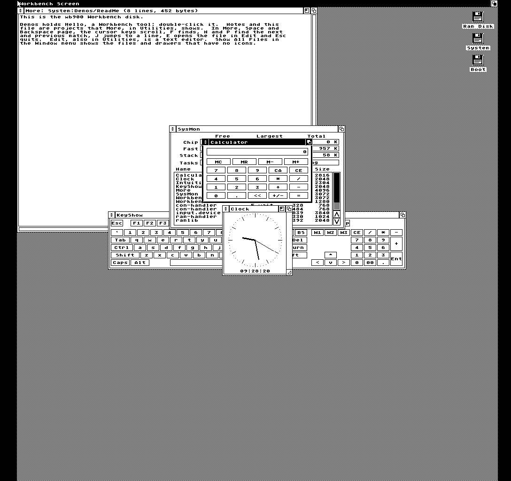

**ScreenMode, the display preferences**

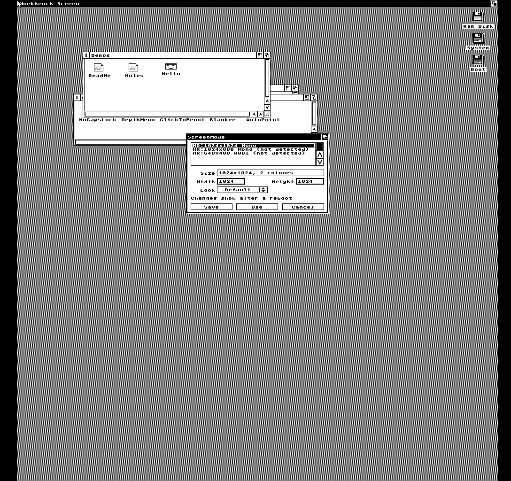

## HR RGBI, 640x400

The HR card in colour, with the wb900 palette.

**Drawers, each where its icon last put it**

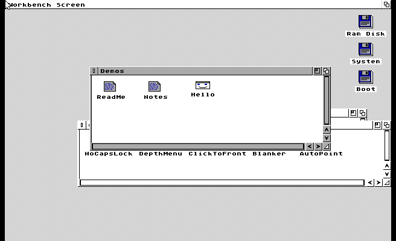

**More, KeyShow, SysMon, Calculator, Clock and a Shell running at once**

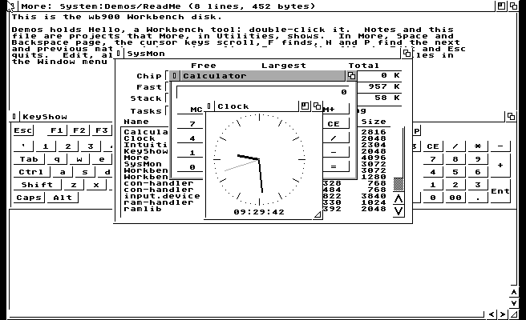

**ScreenMode, the display preferences**

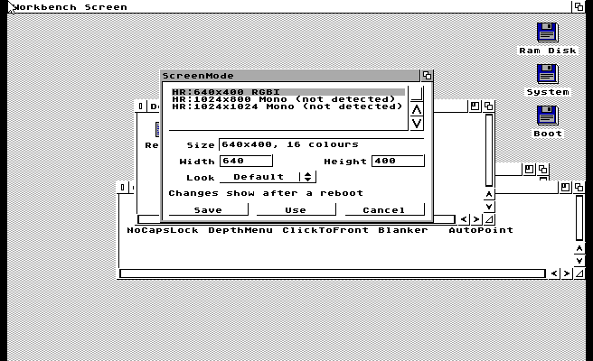

## HR RGBI, 640x400, Workbench 1.x colours

The same mode with the Workbench 1.x palette (Devs/system-configuration.1x).

**Drawers, each where its icon last put it**

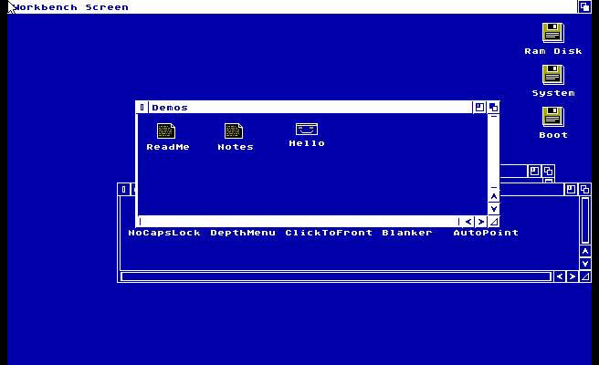

**More, KeyShow, SysMon, Calculator, Clock and a Shell running at once**

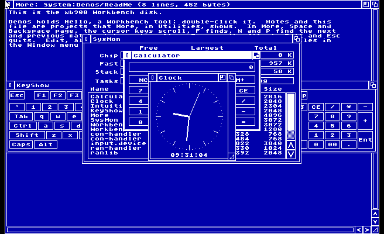

**ScreenMode, the display preferences**

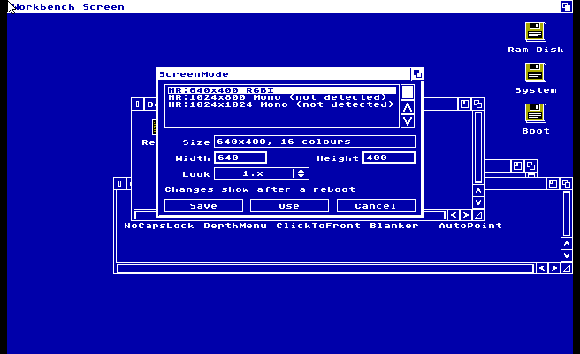

## LC, 640x200

The LC card (8568 VDC) in its first mode, with the 1.x palette.

**Drawers, each where its icon last put it**

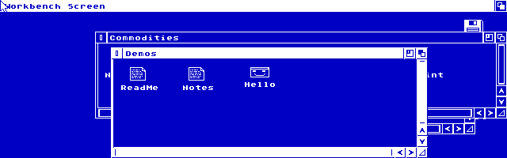

**More, KeyShow, SysMon, Calculator, Clock and a Shell running at once**

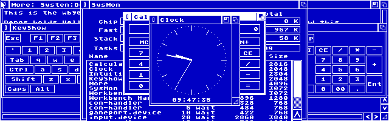

**ScreenMode, the display preferences**

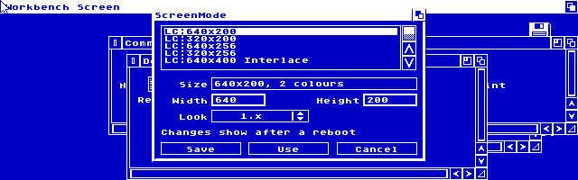

## LC, 640x400 interlaced

The LC card interlaced, as the Amiga's 640x400 mode.

**Drawers, each where its icon last put it**

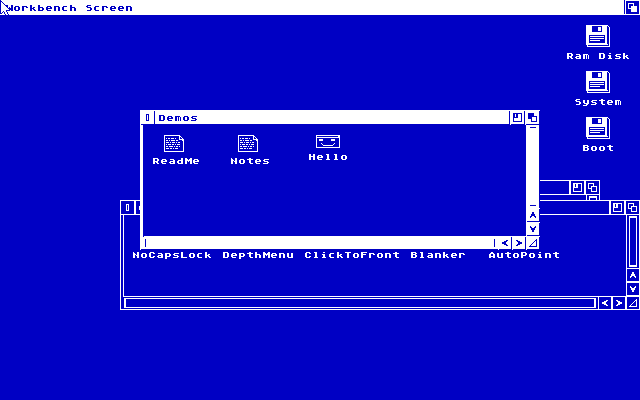

**More, KeyShow, SysMon, Calculator, Clock and a Shell running at once**

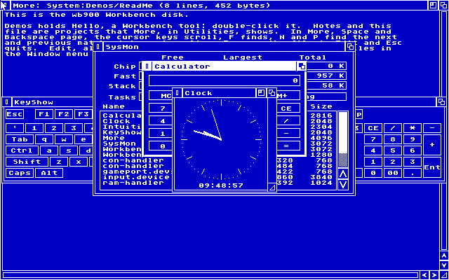

**ScreenMode, the display preferences**

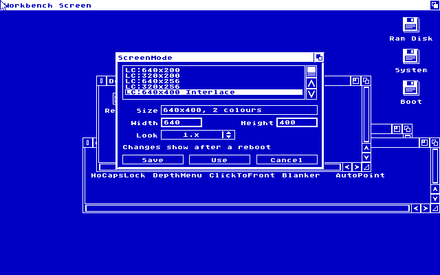
